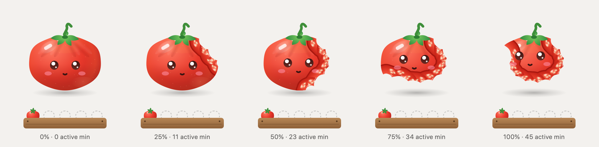
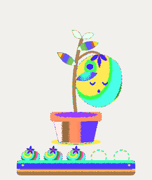
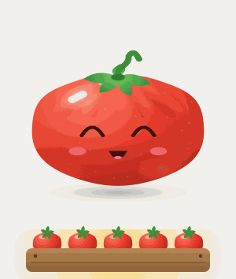
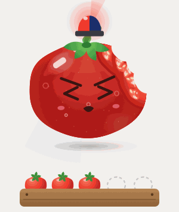

# Pomodoro

**Tomo, a cute tomato that sits on your Mac, keeps you on one task, and gets eaten bite by bite as you actually work.**



- **Counts only real work.** The clock fills with *active* minutes: your task's app in front, recent typing or progress, the page on topic. An open window that you're not using doesn't count.
- **Keeps distractions out, gently.** Other apps are hidden (never quit) while a session runs. Drift and Tomo goes *hmmph*, then simmers, boils, and finally sounds a siren. Get back on track or tap Tomo and it calms down at once.
- **Breaks that restore you.** Each break starts with guided breathing (cyclic sighing, or box breathing), then real rest while the next tomato regrows and ripens.
- **A daily harvest.** Five tomatoes = 5 × 45 active minutes. Any session length works; the crate fills by minutes. Finishing the day gets a little dance.
- **Private by design.** Everything stays on your Mac: no account, no network, no API key. Sessions live in a local SQLite file you can export as CSV.

|  |  |  |
|---|---|---|
| The ripe tomato jumps off the vine | Full harvest | Ignored the boil? Siren. |

## Install

**Download:** grab `Pomodoro-<version>.dmg` from [Releases](https://github.com/Nam-Aniket/pomodoro/releases), open it, drag Pomodoro to Applications. It is free and not notarized (that needs a paid Apple developer account), so the **first launch is right-click → Open → Open**. Needs macOS 14 (Sonoma) or later; runs natively on Apple silicon and Intel.

**Build it yourself** (needs the Xcode command-line tools):

```bash
git clone https://github.com/Nam-Aniket/pomodoro.git
cd pomodoro
tools/make_app.sh
```

## Use

- **First launch:** pick what you want to focus on. Any app works (VS Code, Notion, Figma...). Pick a **browser** and you can add links instead: paste `github.com/you/repo` and every GitHub page counts, anything else is off track. Tick the few apps allowed to stay open.
- **Tap Tomo** to start one of your profiles, or *Other* with a typed task. Lengths 15 to 90 minutes.
- **Hold Tomo 1.5 s** to pause or resume. Quit (⌘Q) remembers your place.
- **Click the leaves** (⌃⌥⌘I) to park an idea without leaving your task: `~/Documents/Pomodoro/ideas-inbox.md`.
- **Emergency exit:** ⌃⌥⌘E, the menu, or Quit. Hidden apps come back.
- **Insights** (⌘I): active time, tomatoes, focus quality, per task; today, week, month. **Focus profiles** from the menu.

## How Tomo knows what you're doing

| Layer | Works for | What it uses | Permission |
|---|---|---|---|
| L0 | any app, no setup | which app is in front, and seconds since your last key or mouse event (never the keys) | none |
| L1 | websites | the front tab's address and title. Full: Chrome, Brave, Edge, Vivaldi, Arc, Opera, Safari, Orion. Firefox and Zen can't report it | Automation, asked once per browser |
| L3 | apps and tools that report | a notification, the `tomo` command, or the MCP server (below) | none |
| L4 | anything else | *Other*: the task you type | none |

## Privacy and permissions

| What Pomodoro reads | Why | Permission |
|---|---|---|
| Which app is in front | to know if you're on task, and to hide distractions | none |
| Seconds since your last key or mouse event (never the keys themselves) | to tell working from idle | none |
| Whether a mic is in use, and whether the Mac is muted | to stay silent during calls and recordings | none |
| The address and title of Chrome's front tab, during sessions that allow Chrome | to check the page fits your task (judged on-device by Apple's sentence model) | Automation, asked once by macOS |

Nothing is sent anywhere. Apps that are never hidden: Claude, Terminal, Finder, System Settings, FaceTime, Activity Monitor and every system process.

## Plug in your own app, a script, or an AI tool

**Your app:** post one notification when a task starts, ends, or makes progress (`phase`: `start`, `end`, `activity`). Then add a profile for your app; the clock will wait for your app's `start`.

```swift
DistributedNotificationCenter.default().postNotificationName(.init("pomodoro.focus"), object: nil,
    userInfo: ["app": "YourApp", "phase": "start", "task": "Chapter 3", "at": ISO8601DateFormatter().string(from: .now)],
    deliverImmediately: true)
```

**Terminal and scripts:** the `tomo` command ships inside the app.

```bash
ln -s /Applications/Pomodoro.app/Contents/MacOS/tomo /usr/local/bin/tomo
tomo start "Writing the report"     # also: end, activity, idea "...", status, today
```

**AI tools (MCP):** `tomo mcp` is a local MCP server (tools: `get_status`, `start_session`, `end_session`, `park_idea`, `today_summary`). It runs as you, on your Mac, so it needs no key. Claude Desktop: add to `claude_desktop_config.json`:

```json
{ "mcpServers": { "pomodoro": { "command": "/Applications/Pomodoro.app/Contents/MacOS/tomo", "args": ["mcp"] } } }
```

Claude Code: `claude mcp add pomodoro -- /Applications/Pomodoro.app/Contents/MacOS/tomo mcp`

## Build and check

- `swift run pomodoro-check`: logic checks (schedule, active clock, ladder, policy, store, rules).
- `Pomodoro --sheet light out.png`: every state drawn side by side. `--eaten`, `--frames <moment> <dir>`, `--reels <dir>`: renders and sound demos.

Design notes and the research behind them: [DESIGN.md](DESIGN.md). Licence: [MIT](LICENSE).
